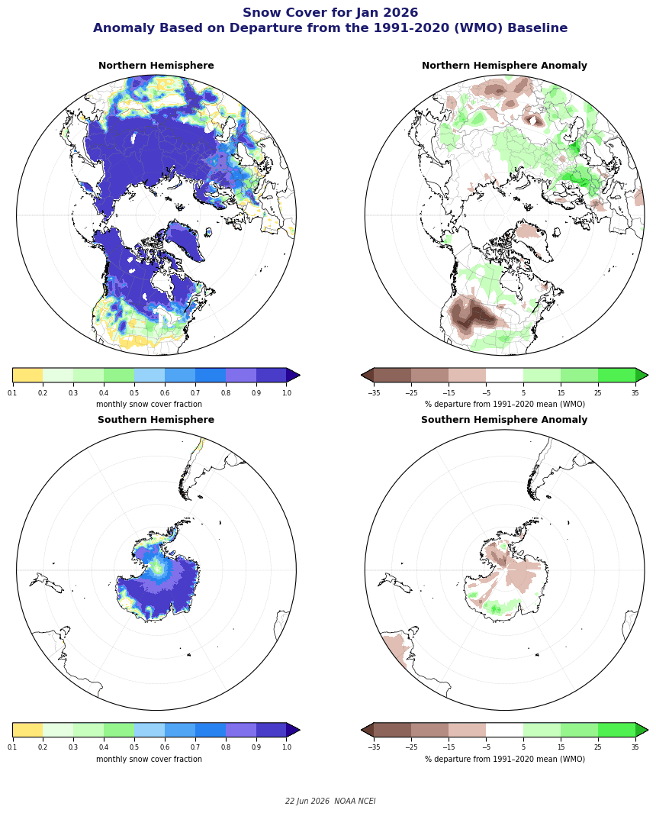
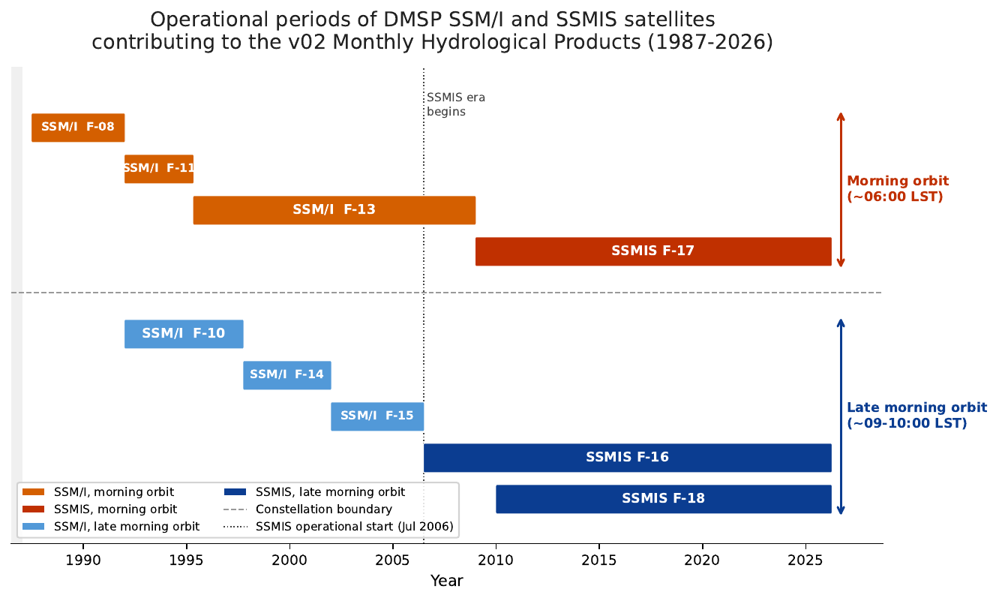
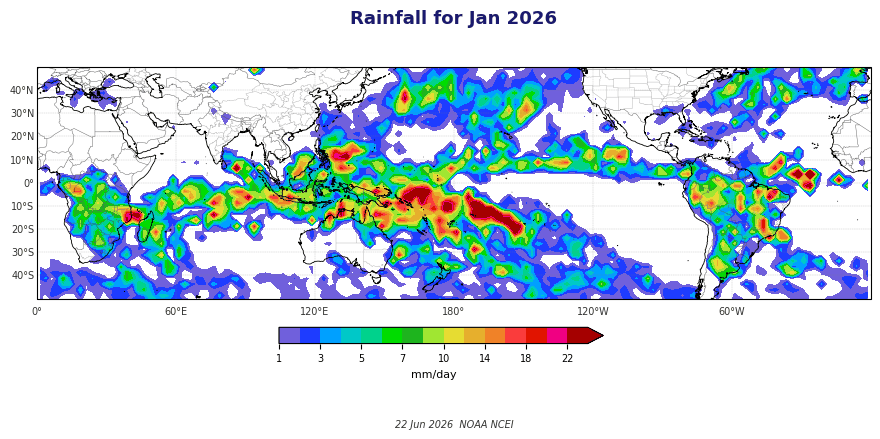

# SSMI(S) Hydrological Products

[](https://github.com/hilawe/ssmis-hydro-products/actions/workflows/ci.yml)

The SSMI(S) Hydrological Products are a long-term record of monthly, globally
gridded passive-microwave fields of hydrological variables, including
precipitation rate and frequency, cloud liquid water, water vapor, snow cover, and
sea ice, beginning in July 1987, at 2.5 and 1.0 degree resolution. They are
derived from the Defense Meteorological Satellite Program (DMSP) Special Sensor
Microwave/Imager (SSM/I) and Special Sensor Microwave Imager/Sounder (SSMIS)
series and produced operationally at NOAA's National Centers for Environmental
Information (NCEI).

The record is used well beyond its own archive. It provides passive-microwave
input to the [Global Precipitation Climatology Project (GPCP) Climate Data
Record](https://www.ncei.noaa.gov/products/climate-data-records/precipitation-gpcp-daily),
and it has contributed every month to the [NOAA Climate Prediction Center (CPC)
Climate Diagnostics
Bulletin](https://www.cpc.ncep.noaa.gov/products/analysis_monitoring/bulletin_0500/index.html).
Sustaining a consistent, well-characterized multi-decadal record across an
evolving satellite constellation, so that downstream products can rely on it
month after month, is the central problem this project addresses.

This repository holds the version 2 processing system, an open-source Python 3
reimplementation of the legacy Fortran77, IDL, and GrADS processing from the daily
1/3-degree antenna-temperature grids onward, with an automated test suite and
continuous integration. Testing it against the legacy code on identical inputs
found three latent defects in the legacy code, an unbounded index into the
antenna-temperature correction table, an unbounded index into the scattering-index
table, and uninitialized variables in the emission branch of the precipitation
retrieval. Version 2 removes them, and with them removed the legacy code and
version 2 agree within 0.001 in product units on the months tested. Version 2 also
corrects the dual-satellite merge of the GPCP input product and updates the
snow-cover anomaly baseline to the World Meteorological Organization 1991-2020
climate normals. The historical record has not yet been reprocessed with
version 2.

## Principal Investigator

Hilawe Semunegus (NOAA NCEI) is the Principal Investigator for the SSMI(S)
Hydrological Products, responsible for the production, scientific
stewardship, validation, and modernization of the record. Ralph R. Ferraro
(University of Maryland ESSIC) is a co-author and the original author of the
retrieval algorithms, which build on the long-established NOAA passive-microwave
hydrology lineage.

## Selected products

Northern and Southern Hemisphere snow cover and anomaly, January 2026:



The DMSP satellite constellation contributing to the record:



Global rainfall, January 2026:



## What is here

- **Climate algorithms** (`monthly/climalg_ssmis.py`): the antenna-to-brightness
  temperature conversion and the precipitation, cloud, water vapor, snow, and sea
  ice retrievals, fully vectorized with NumPy.
- **Monthly assembly** (`monthly/combine.py`, `monthly/pentad_ssmis.py`): multi-year
  record management and 5-day pentad averaging.
- **GPCP merge** (`monthly/gpcp_processing.py`): snow and ice masking and the
  dual-satellite precipitation merge.
- **NetCDF-CF export and validation** (`monthly/netcdf/`): CF-1.5 output and a
  validation harness against the legacy reference.
- **Imagery** (`monthly/grads/run_mon_image.py`): matplotlib and cartopy figures
  that replaced the legacy GrADS scripts.
- **Configuration** (`monthly/satellite_config.py`, `monthly/product_version.py`):
  a single source of truth for the satellite constellation and the product
  version, so a satellite transition is a configuration change.
- **Tests** (`tests/`): a pytest suite covering the radiometric conversion, the
  binary and NetCDF I/O contracts, grid geometry, retrieval invariants, and a
  deterministic bitwise golden-month regression. Continuous integration runs it
  on every push.

## Running the tests

```bash
pip install -r requirements-test.txt   # plus numpy, scipy, netCDF4
python -m pytest tests
```

Tests that require a third-party library or the operational input grids skip
cleanly when those are unavailable, so the suite runs on any host with the
scientific Python stack. The golden-month regression runs only where the
1/3-degree input grids are mounted.

## Scientific and engineering highlights

- A multi-decadal, multi-sensor record kept as two chains, morning and late
  morning, each a sequence of DMSP satellites, so users have two samplings of the
  diurnal cycle.
- Operational input to the GPCP Climate Data Record and to the monthly CPC
  Climate Diagnostics Bulletin.
- Defects found by testing against the legacy code are removed, and the effect of
  removing them is measured over a full year of matched inputs rather than
  assumed.
- The binary format contract (float32, south-first rows, longitude-fastest) and
  the NetCDF metadata are pinned by the test suite, not just documentation.

## Citation and data

- The version 2 processing corrections and their evaluation are described in
  "Evaluation and Processing Corrections for the SSMI(S) Hydrological Products" by
  Hilawe Semunegus and Ralph R. Ferraro, in revision at the Journal of Applied
  Meteorology and Climatology.
- The archive of record is held at NOAA's National Centers for Environmental
  Information,
  [doi:10.7289/V5QF8R3K](https://doi.org/10.7289/V5QF8R3K).
- A corrected 2024 sample year produced by version 2 is archived on Zenodo,
  [doi:10.5281/zenodo.23424220](https://doi.org/10.5281/zenodo.23424220).
- The processing source is also archived on Zenodo under the concept DOI
  [10.5281/zenodo.20127244](https://doi.org/10.5281/zenodo.20127244), which
  resolves to the latest released version.

## License

Public domain under Creative Commons Zero 1.0 (see `LICENSE`).
