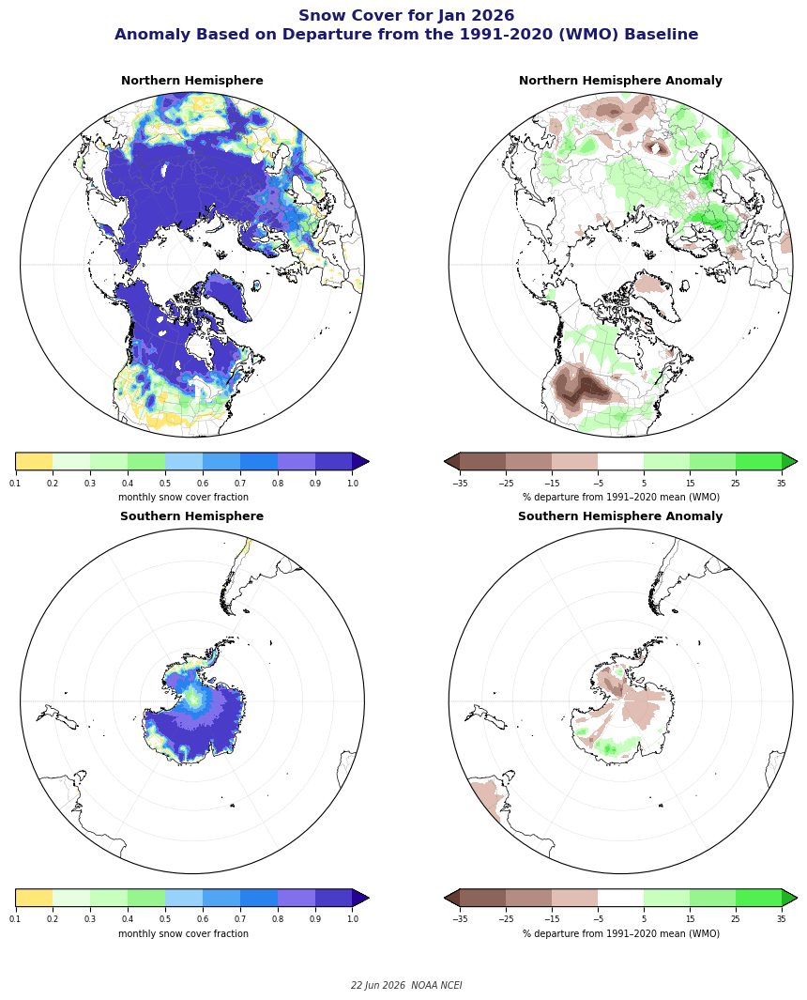
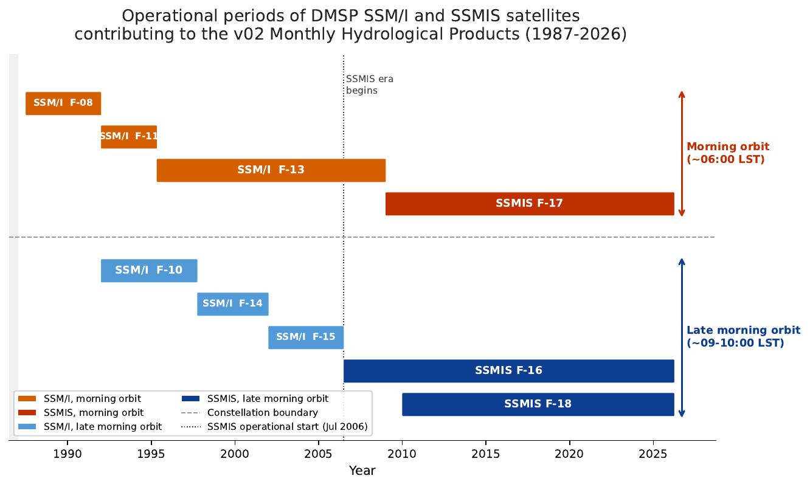
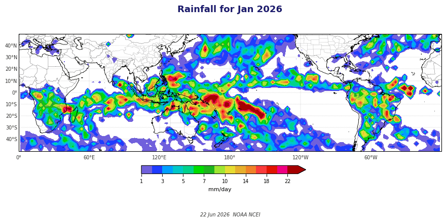

# SSMI(S) Hydrological Products

[](https://github.com/hilawe/ssmis-hydro-products/actions/workflows/ci.yml)

The SSMI(S) Hydrological Products are a long-term record of monthly, globally
gridded passive-microwave fields of hydrological variables, including
precipitation rate and frequency, cloud liquid water, water vapor, snow cover, and
sea ice, beginning in July 1987, at 2.5 and 1.0 degree resolution. They are
derived from the Defense Meteorological Satellite Program (DMSP) Special Sensor
Microwave/Imager (SSM/I) and Special Sensor Microwave Imager/Sounder (SSMIS)
series and produced operationally at NOAA's National Centers for Environmental
Information (NCEI).

The record is used well beyond its own archive. It provides passive-microwave
input to the [Global Precipitation Climatology Project (GPCP) Climate Data
Record](https://www.ncei.noaa.gov/products/climate-data-records/precipitation-gpcp-daily),
and it has contributed every month to the [NOAA Climate Prediction Center (CPC)
Climate Diagnostics
Bulletin](https://www.cpc.ncep.noaa.gov/products/analysis_monitoring/bulletin_0500/index.html).
Sustaining a consistent, well-characterized multi-decadal record across an
evolving satellite constellation, so that downstream products can rely on it
month after month, is the central problem this project addresses.

This repository holds the version 2 processing system, an open-source Python 3
reimplementation of the legacy Fortran77, IDL, and GrADS processing from the daily
1/3-degree antenna-temperature grids onward, with an automated test suite and
continuous integration. Testing it against the legacy code on identical inputs
found three latent defects in the legacy code, an unbounded index into the
antenna-temperature correction table, an unbounded index into the scattering-index
table, and uninitialized variables in the emission branch of the precipitation
retrieval. Version 2 removes them, and with them removed the legacy code and
version 2 agree within 0.001 in product units on the months tested. Version 2 also
corrects the dual-satellite merge of the GPCP input product and updates the
snow-cover anomaly baseline to the World Meteorological Organization 1991-2020
climate normals. The historical record has not yet been reprocessed with
version 2. Monthly production for the archive still runs on the legacy code, and
version 2 is run beside it on the same inputs, without delivering files, until
NCEI is ready to receive version 2 products.

## Project status, 25 November 2026

- **Monthly production.** Products have been made through October 2026. The October
  products were made on 2 November 2026 with the legacy system, and November
  follows in early December.
- **Version 2.** It runs beside the legacy system each month on the same inputs
  and delivers no files yet. Delivery starts when NCEI is ready to receive
  version 2 products.
- **Paper.** The revised manuscript went to the Journal of Applied Meteorology and
  Climatology on 16 October 2026 and is under review.
- **Successor sensors.** The AMSR2 conversion has run as a parallel, unpublished
  stream beside F-16 since November 2026, and input from the WSF-M Microwave
  Imager is under evaluation. No successor satellite is activated, and no
  successor product is delivered.

## Principal Investigator

Hilawe Semunegus (NOAA NCEI) is the Principal Investigator for the SSMI(S)
Hydrological Products, responsible for the production, scientific
stewardship, validation, and modernization of the record. Ralph R. Ferraro
(University of Maryland ESSIC) is a co-author and the original author of the
retrieval algorithms, which build on the long-established NOAA passive-microwave
hydrology lineage.

## Selected products

Northern and Southern Hemisphere snow cover and anomaly, January 2026:



The DMSP satellite constellation contributing to the record:



Global rainfall, January 2026:



## What is here

- **Climate algorithms** (`monthly/climalg_ssmis.py`): the antenna-to-brightness
  temperature conversion and the precipitation, cloud, water vapor, snow, and sea
  ice retrievals, fully vectorized with NumPy.
- **Monthly assembly** (`monthly/combine.py`, `monthly/pentad_ssmis.py`): multi-year
  record management and 5-day pentad averaging.
- **GPCP merge** (`monthly/gpcp_processing.py`): snow and ice masking and the
  dual-satellite precipitation merge.
- **NetCDF-CF export and validation** (`monthly/netcdf/`): CF-1.5 output and a
  validation harness against the legacy reference.
- **Imagery** (`monthly/grads/run_mon_image.py`): matplotlib and cartopy figures
  that replaced the legacy GrADS scripts.
- **Configuration** (`monthly/satellite_config.py`, `monthly/product_version.py`):
  a single source of truth for the satellite constellation and the product
  version, so a satellite transition is a configuration change.
- **WSF-M input adapter** (`monthly/wsfm_adapter.py`): grids orbit files of
  predicted SSMIS antenna temperatures for the Weather System Follow-on -
  Microwave (WSF-M) satellite into the same daily 1/3-degree format, reproducing
  the operational decoder's gridding, encoding and fill rules. It is experimental.
  The WSF-M entry in the configuration is disabled, and publishing the adapter
  activates no satellite and accepts no WSF-M product.
- **AMSR2 conversion** (`conversion/amsr2/route_a/`): a reader and a fixed set of
  quantile maps that turn Colorado State University's brightness temperatures from
  the Advanced Microwave Scanning Radiometer 2 (AMSR2) into daily grids in the same
  1/3-degree format. It is provisional. It has run as a parallel, unpublished stream
  beside F-16 since November 2026, and publishing it activates no stream and accepts
  no product. Its README gives the measured differences from F-16, the limits and
  the dataset citation.
- **Land/sea tag and lookup tables** (`monthly/NLNDSEA.TAG`, `monthly/lut_add_ocean`,
  `monthly/lut_add_land`, `monthly/lut_add_si`): the files the processor reads,
  inherited with the legacy processing package and included unchanged. The
  conversion's README states what is and is not recorded about them.
- **2.5-degree land/sea file** (`monthly/lndsea.25d`): the 144 by 72 grid that
  `gpcp_processing.py` reads to apply its coastal masks. It came with the legacy
  processing package, whose GPCP programs read it, and is included unchanged
  (41,472 bytes, SHA-256
  `2a9a6f3184b3bb34e13088f152366feb88c80e96775f61857887a4919bef4e6d`). It is byte
  for byte the file in versions 2.0.1 and 2.1.0 of this project's Zenodo code
  deposit. No record at hand names the data it was made from.
- **Tests** (`tests/`): a pytest suite covering the radiometric conversion, the
  binary and NetCDF I/O contracts, grid geometry, retrieval invariants, the WSF-M
  adapter's parity with the operational decoder's rules on synthetic inputs, and a
  deterministic bitwise golden-month regression. Continuous integration runs it
  on every push.

Two inputs of the GPCP step are not here. `gpcp_processing.py` rebuilds its files
from the first month of the record on every run, so it reads the multi-year monthly
product files of each chain, which are data and are made by the steps before it.
For July 1990 to December 1991 of the morning chain it also reads a monthly snow
climatology, `monthly/snow/SN01` to `SN12` (twelve 144 by 72 grids of 41,472 bytes
each), in place of that month's own snow product. The climatology came with the
legacy processing package. It is not in this repository, and versions 2.0.1 and
2.1.0 of the Zenodo code deposit do not hold it. The preparation notes of version
2.1.0 list the SHA-256 of each of the twelve files. No record at hand names the
data the climatology was made from. The masking tests write small stand-ins for
it, so they show the rule and not a run of the historical record.

## Running the tests

```bash
pip install -r requirements-test.txt   # plus numpy, scipy, netCDF4
python -m pytest tests conversion
```

Tests that require a third-party library or the operational input grids skip
cleanly when those are unavailable, so the suite runs on any host with the
scientific Python stack. The golden-month regression runs only where the
1/3-degree input grids are mounted.

## Scientific and engineering highlights

- A multi-decadal, multi-sensor record kept as two chains, morning and late
  morning, each a sequence of DMSP satellites, so users have two samplings of the
  diurnal cycle.
- Operational input to the GPCP Climate Data Record and to the monthly CPC
  Climate Diagnostics Bulletin.
- Defects found by testing against the legacy code are removed, and the effect of
  removing them is measured over a full year of matched inputs rather than
  assumed.
- The binary format contract (float32, south-first rows, longitude-fastest) and
  the NetCDF metadata are pinned by the test suite, not just documentation.

## Citation and data

- The version 2 processing corrections and their evaluation are described in
  "Evaluation and Processing Corrections for the SSMI(S) Hydrological Products" by
  Hilawe Semunegus and Ralph R. Ferraro, in revision at the Journal of Applied
  Meteorology and Climatology (manuscript JAMC-D-26-0147).
- The archive of record is held at NOAA's National Centers for Environmental
  Information,
  [doi:10.7289/V5QF8R3K](https://doi.org/10.7289/V5QF8R3K).
- A corrected 2024 sample year produced by version 2 is archived on Zenodo,
  [doi:10.5281/zenodo.23424220](https://doi.org/10.5281/zenodo.23424220).
- The processing source is also archived on Zenodo under the concept DOI
  [10.5281/zenodo.20127244](https://doi.org/10.5281/zenodo.20127244), which
  resolves to the latest released version. This repository can be ahead of that
  release, so a citation of code run from here should name the commit.

## License

Public domain under Creative Commons Zero 1.0 (see `LICENSE`).
